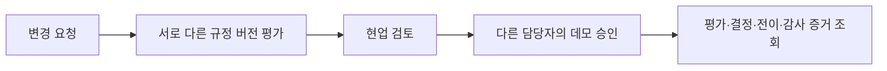

# CaseProof Enterprise

합성 보험 규정에 대한 숫자 주장을 검증하고, 담당자 검토·별도 승인·감사 증거를 연결하는 Python 포트폴리오 프로젝트입니다.

현재는 **가상 손보·생보 업무팩을 사용하는 로컬 시제품**입니다. 실제 LLM 연결, 실제 보험금 지급·계약 판단, 실고객 정보 처리 기능은 없습니다.

## 구현한 흐름



- 인증된 사용자와 테넌트에 따라 요청·조회·평가·승인 권한을 분리합니다.
- 상태값만 바꾸어 검토를 건너뛰는 결함을 실제 API/SQLite에서 재현한 뒤, 전이 원장과 감사·결정 기록을 교차 검증하도록 수정했습니다.
- 승인 직전의 평가·현업 결정·이벤트를 고정하고 최종 승인 증거와 연결합니다. 기록이 어긋나면 승인을 차단합니다.
- 생성·평가·제출·현업 결정·최종 결정의 중복 전송을 처리합니다. 같은 요청은 저장된 응답을 재생하고, 같은 키의 다른 요청은 거부합니다.
- 화면은 통신 오류 후 재시도할 때 같은 요청 키를 유지하며 최신 상태와 증거를 별도로 조회합니다.

## 기술과 검증

Python 3.12 · FastAPI · Pydantic v2 · SQLAlchemy · SQLite · 정적 HTML/JavaScript · pytest

2026-10-29 신규 합성 SQLite 환경에서 **157개 테스트와 하위 검사 22개**, 스모크 **12/12**가 통과했습니다. 요청 키를 유지하는 화면 로직은 Node에서 검증했고, localhost 서버의 HTML·상태 응답·OpenAPI를 확인했습니다. 브라우저 클릭 E2E와 PostgreSQL은 이번 실행에서 검증하지 않았습니다.

Windows 소켓 초기화 오류를 피하기 위해 검증 전용 실행기를 사용했습니다. 세부 명령, 실패→수정→통과 로그와 한계는 [개발 상태](DEVELOPMENT_STATUS.md) 및 [최신 실행 증거](current/reports/runs/20261029T142554Z-0b8c51e9/)에 있습니다. 이 테스트 수치는 모델 정확도나 운영 인증 수치가 아닙니다.

## 로컬 실행

```powershell
cd current
py -3.12 -m venv .venv
.\.venv\Scripts\python.exe -m pip install -r requirements-dev.txt
$env:CASEPROOF_DEMO_MODE = '1'
# 기존 DB를 보존하고, 아직 존재하지 않는 새 합성 DB 경로를 사용합니다.
$env:CASEPROOF_DATABASE_URL = 'sqlite:///./caseproof_portfolio.sqlite3'
.\.venv\Scripts\python.exe -m service.cli init-demo
.\.venv\Scripts\python.exe -m uvicorn service.app:app --host 127.0.0.1 --port 8000 --workers 1
```

`http://127.0.0.1:8000/`에서 초기화 시 출력되는 합성 사용자 토큰으로 접속합니다. 요청자 → 현업 검토자 → 최종 승인자로 사용자를 전환합니다. 토큰을 저장소에 올리지 않습니다. 이전 DB를 새 스키마로 자동 변환하는 기능은 아직 없습니다.

```powershell
# Windows 검증 실행법
.\.venv\Scripts\python.exe -m scripts.windows_checks pytest -q
.\.venv\Scripts\python.exe -m scripts.windows_checks scripts.smoke
```

## 저장소 안내

| 경로 | 내용 |
|---|---|
| `current/service/` | API, 관계형 모델, 권한·전이·재시도 처리, 화면 |
| `current/reference/`, `current/datasets/` | 결정론적 규정 엔진과 합성 입력 |
| `current/tests/` | HTTP·SQLite·권한·변조·경합·롤백·응답 유실 회귀 |
| `current/reports/runs/` | 실행별 환경·명령·결과·원본 해시 |
| `prebuild/` | v5.2 목표 설계와 G0–G6 구현·인수 계획 |
| `independent_audit/`, `legacy/`, `current/archive_*/` | 이전 감사 및 설계 기록 |

개발에는 Codex와 모델 라우터, 작업별 에이전트·독립 코드 리뷰를 활용했습니다. 설계 목표와 실제 구현·검증 결과를 구분해 기록합니다. 다음 단계는 PostgreSQL 마이그레이션·RLS·동시성 및 브라우저 업무 흐름 검증입니다. 외부 신뢰 앵커·SSO·실무자 검수·실제 모델 비교실험은 남아 있습니다.
