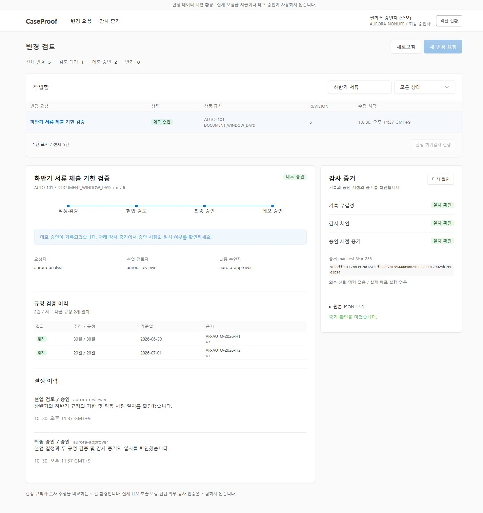

# CaseProof

**A synthetic insurance-rule verification and human-review prototype.**

CaseProof checks a numeric claim against versioned synthetic rules, records the evidence, and requires different people to request, review, and approve a demo change. The project is useful for studying authorization, temporal rule resolution, regression evidence, and approval integrity.

**Release: `5.3.0.dev5` — versioned review, evaluation and evidence workspace.** The explicit `/api/v1` profile provides atomic revisions, full-suite runs, linked corrections, separate reviewers and reconstructed evidence. The original `/api` profile remains available. PostgreSQL role/RLS tests, exact paired statistics and local recovery exercises have separate evidence; external models, anchors and independent reviews remain unavailable.

합성 규칙의 변경을 평가하고, 요청자·현업 검토자·최종 승인자의 역할을 분리합니다. 전이 원장과 고정 승인 증거로 변경 이력을 대조하며, 요청 재시도로 같은 변경이 중복 처리되는 것을 방지합니다. 구현 범위와 실행 결과는 [현재 상태](docs/STATUS.md)와 [검증 기록](docs/VALIDATION.md), 버전 통합 내역은 [병합 기록](docs/V53_INTEGRATION.md)에서 확인할 수 있습니다.

- Synthetic fixtures only; no real customer information or insurance decisions.
- FastAPI, SQLAlchemy, SQLite, static HTML/JavaScript; one local server worker.
- Two fictional organizations, four roles, ten synthetic rules and twenty public resolver examples; transition records and actor-scoped retries for every mutation.
- No LLM connection, production authentication, PostgreSQL RLS, externally anchored evidence, or completed 360-case study.
- `PASS` means the tested numeric claim matched a synthetic rule. `APPROVED_FOR_DEMO` never deploys software or authorizes a real claim.

한국어 시작 안내: [START_HERE.md](START_HERE.md). Codex 구현 진입점: [AGENTS.md](AGENTS.md), [실행 프롬프트](prebuild/05_CODEX_KICKOFF.md).

## Review workspace

The interface uses [Tabler 1.7.3](https://docs.tabler.io/ui/getting-started), with the MIT stylesheet and notices included locally. Searchable request tables, evaluation results, decision forms and evidence checks use its standard components. No CDN or external font is required. Three different accounts perform request, domain review and final demo approval; uncertain responses can be recovered using the original request. See [UI scope and validation](docs/UI_WORKSPACE.md).



[Narrow-screen capture](docs/images/review-mobile.jpg). Screenshots show an actual temporary synthetic workflow; counts and approvals are recorded test data.

## Versioned workspace

```powershell
$env:CASEPROOF_DEMO_MODE = '1'
.\.venv\Scripts\python.exe -m pip install --require-hashes -r requirements-dev.lock
.\.venv\Scripts\python.exe -m scripts.windows_checks scripts.v1_demo --port 8766
```

Open `http://127.0.0.1:8766/v1`. The command creates a new disposable profile and prints its path. Copy role tokens from that ignored local `profile.json`; tokens are never published or stored in browser persistent storage. Restart with `--profile <path>` to preserve the same synthetic database. No migration or seeding runs on application startup. See [workspace details](docs/G4_WORKSPACE.md), [policy packs](docs/G3_POLICIES.md), [PostgreSQL checks](docs/G2_POSTGRES.md), and [local recovery](docs/operations/RECOVERY.md).

Optional test environments use separate hash locks: `requirements-evaluation.lock` for NumPy statistics and `requirements-postgres.lock` for PostgreSQL. The [readiness checklist](docs/operations/RELEASE_READINESS.md) separates local exercises from unavailable external evidence.

## Quick start

Python 3.11–3.13 is the declared support target. See [validation](docs/VALIDATION.md) for versions actually run. Node.js is only needed for the JavaScript syntax check. No cloud account or API key is needed.

### Windows PowerShell

```powershell
py -3.12 -m venv .venv
.\.venv\Scripts\python.exe -m pip install --require-hashes -r requirements-dev.lock
$env:CASEPROOF_DEMO_MODE = '1'
.\.venv\Scripts\python.exe -m service.cli init-demo
.\.venv\Scripts\python.exe -m uvicorn service.app:app --host 127.0.0.1 --port 8000 --workers 1
```

Activation is optional; these commands avoid PowerShell activation-policy issues. Use another supported Python minor if 3.12 is unavailable.

### macOS / Linux

```bash
python3 -m venv .venv
.venv/bin/python -m pip install --require-hashes -r requirements-dev.lock
export CASEPROOF_DEMO_MODE=1
.venv/bin/python -m service.cli init-demo
.venv/bin/python -m uvicorn service.app:app --host 127.0.0.1 --port 8000 --workers 1
```

Open [http://127.0.0.1:8000](http://127.0.0.1:8000). The initializer prints freshly generated local tokens once. Keep them private; they do not expire automatically. Change roles with **연결 해제 / 역할 변경**. Tokens remain in browser memory only. Initialization does not reset an existing database or reissue its credentials. For another demo, choose a **new database path** using `CASEPROOF_DATABASE_URL` and pass the same path to `init-demo --database`; do not delete an unknown database.

## Five-minute scenario

1. Sign in as `aurora-analyst`; create a change for `AUTO-101 / DOCUMENT_WINDOW_DAYS`.
2. Evaluate `30` days on `2026-06-30`, then `20` days on `2026-07-01`.
3. Submit for domain review. Sign in as `aurora-reviewer`, inspect evidence and record a meaningful approval reason.
4. Sign in as `aurora-approver` and approve for the demo with a reason.
5. Inspect evidence: audit and record checks should be true; `external_trust_anchor` and `real_release` stay false.

A failed evaluation blocks this baseline change. Create a fresh change to try again. The target design introduces complete, immutable evaluation runs and a linked correction workflow; those are future work.

## Checks

Run from the repository root with the virtual environment's Python:

```bash
python -m pytest -q
python -m scripts.smoke
python -m scripts.check_ui_syntax
python -m scripts.check_package
```

Smoke reports use new `reports/runs/<run-id>/` paths. To choose another **new** output path: `python -m scripts.smoke --output reports/my-run/smoke.json`. Existing reports are never overwritten. Test tokens are public test fixtures used only with disposable databases; they are not login credentials for the CLI demo.

Optional isolated browser scenario:

```bash
python -m pip install --require-hashes -r requirements-browser.lock
python -m playwright install chromium
python -m scripts.browser_e2e
```

This starts its own local server and temporary database, then cleans up only the files it created. A browser installation or execution failure is a failed/unrun check, not a browser PASS.

The included GitHub Actions workflow defines fresh CI runs. A workflow file is not proof GitHub executed it. Dependency audit and Docker/browser/platform checks are reported separately in [VALIDATION.md](docs/VALIDATION.md).

## Implementing the next version

| Path | Purpose |
| --- | --- |
| [prebuild/01_TARGET_DESIGN.md](prebuild/01_TARGET_DESIGN.md) | Product scope, design decisions, invariants |
| [prebuild/08_IMPLEMENTATION_CONTRACTS.md](prebuild/08_IMPLEMENTATION_CONTRACTS.md) | Exact target API, transactions, state/evidence and data contracts |
| [prebuild/02_IMPLEMENTATION_PLAN.md](prebuild/02_IMPLEMENTATION_PLAN.md) | Dependency-ordered tasks with file, test and acceptance details |
| [contracts/README.md](contracts/README.md) | Machine-readable target schemas and examples; not deployed routes |
| [docs/STATUS.md](docs/STATUS.md) | Implemented vs planned capability matrix |
| [docs/PUBLISHING.md](docs/PUBLISHING.md) | GitHub publishing and release procedure |
| [docs/PROVENANCE.md](docs/PROVENANCE.md) | Origin, retained code, exclusions and license boundaries |

Prefer a modular monolith and one end-to-end slice per task. Full enterprise functionality, real-model experiments, SME review, and external operations evidence remain separate gates. No score or “production ready” label is earned by the number of documents or tests.

## Contributing and security

Read [CONTRIBUTING.md](CONTRIBUTING.md), [SECURITY.md](SECURITY.md), and [CODE_OF_CONDUCT.md](CODE_OF_CONDUCT.md). Original project files are offered under [Apache-2.0](LICENSE); dependency licenses are separate. Before the first public publication, the maintainer must confirm rights to the imported original code and enable a real private security-reporting channel. No release has been published by preparing this package.
