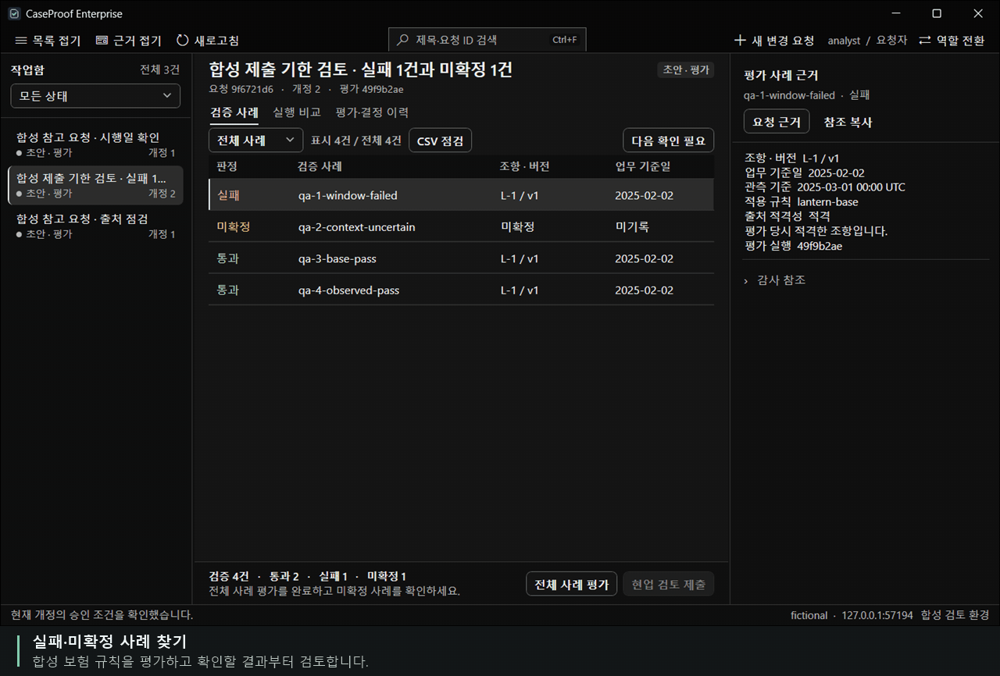
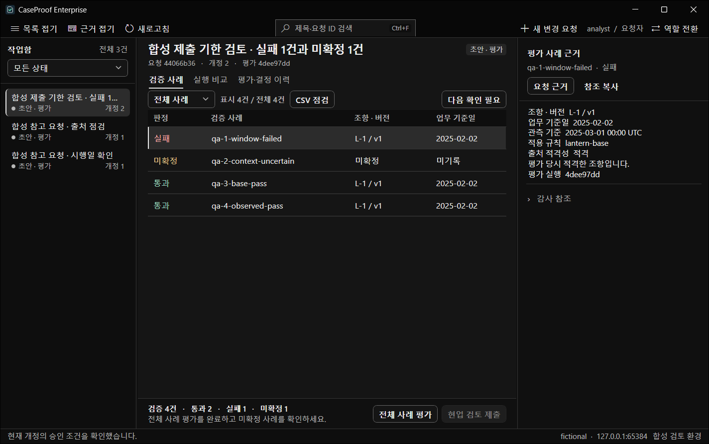
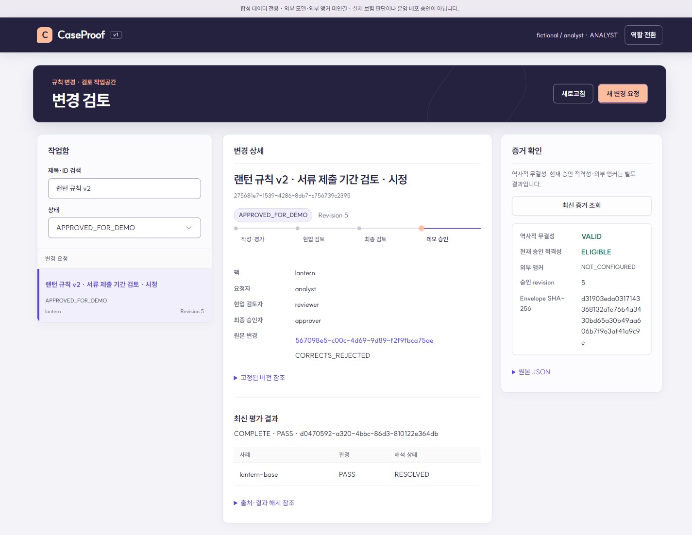

# CaseProof Enterprise

**보험 규칙 변경을 평가하고, 어떤 사례와 근거로 승인했는지 확인하는 Windows·웹 작업대입니다.**

합성 데이터로 변경 전후 판정을 비교하고, 실패한 사례의 조항·규칙 버전·업무 기준일을 확인할 수 있습니다. 요청자, 현업 검토자, 최종 승인자는 각자의 권한으로 같은 요청을 처리합니다.

[Windows x64 다운로드](https://github.com/KIMJINWOO0548/CaseProof_Enterprise/releases/latest) · [Windows 실행 안내](desktop/README.ko.md) · [웹 시작 안내](START_HERE.md)



*합성 데이터로 실행한 Windows 포터블 앱의 화면을 15초로 편집했습니다.*

## Windows 작업대

한 창에서 요청을 열고 실패·미확정 사례를 살펴보며 저장된 평가를 비교합니다. 판정 옆에서 적용 조항, 규칙 버전, 업무 기준일을 확인할 수 있습니다. 웹과 같은 `/api/v1`을 사용하며, 검토자 역할을 분리하고 응답 유실 후 원래 결정 결과를 복구합니다.



[실행과 로컬 빌드](desktop/README.ko.md) · [Windows UI 자동화 검증](docs/evidence/windows-workbench-density-checks.json) · [main CI와 Windows 빌드 결과](https://github.com/KIMJINWOO0548/CaseProof_Enterprise/actions/workflows/ci.yml?query=branch%3Amain)

## 웹 검토 작업대

검색할 수 있는 요청 목록과 현재 처리 단계가 표시됩니다. 평가와 근거는 별도 영역으로 보여 주며, 요청을 선택하면 두 영역이 함께 갱신됩니다. 웹은 CDN 없이 실행되며, 번들된 [Tabler 1.7.3](https://docs.tabler.io/ui/getting-started)과 OFL-1.1 SUIT 글꼴을 사용합니다. [화면 설계](docs/VISUAL_DESIGN.md) · [참고 제품의 근거 검토 방식](docs/AI_UI_REFERENCES.md) · [오류·포커스 점검](docs/UI_FOCUS_AUDIT.md)



[좁은 웹 화면](docs/images/v1-review-mobile.jpg)도 합성 요청과 시연 승인 결과를 보여 줍니다.

## 기술 및 검증 범위

서버 `5.3.0.dev6`의 `/api/v1`은 개정, 전체 사례 평가, 정정 연결, 독립 승인, 승인 당시의 근거 조회를 제공합니다. 전이 원장과 고정 승인 증거로 변경 이력을 대조하며, 요청을 다시 보내도 변경이 중복 처리되지 않도록 합니다. 기존 `/api` 프로필도 실행할 수 있습니다. [현재 상태](docs/STATUS.md) · [검증 기록](docs/VALIDATION.md) · [버전 통합 내역](docs/V53_INTEGRATION.md)

- Windows 작업대는 .NET/WPF, 서버와 웹은 FastAPI·SQLAlchemy·HTML/JavaScript를 사용합니다. 로컬 시연은 SQLite로 실행합니다. PostgreSQL 권한·행 단위 보안, 통계, 로컬 복구의 검증 결과는 개별 기록에서 확인할 수 있습니다.
- 합성 데이터만 사용합니다. `/api`에는 가상 조직 2개, 역할 4개, 규칙 10개와 예제 20개가 있습니다. 별도 `/api/v1` 작업 공간에는 합성 규칙 팩 3개가 있습니다. 두 프로필에서 각 사용자 단위로 재시도를 처리합니다.
- LLM 연동, 운영 인증, 외부 증거 앵커, 360건 연구 및 외부 독립 검토는 별도 범위입니다. PostgreSQL 권한 실험은 운영 배포 수용을 검증하지 않습니다.
- `PASS`는 사례의 숫자가 합성 규칙과 일치했다는 의미입니다. `APPROVED_FOR_DEMO`는 시연 승인만을 의미합니다.

## 버전이 보존되는 작업대

합성 시연 작업대는 요청을 보내기 전에 내용을 보관합니다. 처리 여부가 불분명하면 같은 브라우저 프로필과 주소에서 다시 로그인한 뒤 **원래 요청 복구**를 선택합니다. [요청 복구와 DB 복원](docs/REQUEST_RECONNECT.md)

저장된 v2 평가는 이력에서 읽거나 기준·후보 실행을 선택해 비교할 수 있습니다. 비교 화면에는 두 실행의 결과와 입력·평가 조건 해시가 표시됩니다. [저장 실행 비교 범위](docs/RUN_COMPARISON.md)

```powershell
py -3.12 -m venv .venv
$env:CASEPROOF_DEMO_MODE = '1'
.\.venv\Scripts\python.exe -m pip install --require-hashes -r requirements-dev.lock
.\.venv\Scripts\python.exe -m scripts.windows_checks scripts.v1_demo --port 8766
```

`http://127.0.0.1:8766/v1`을 엽니다. 실행 명령이 일회용 프로필을 만들고 폴더 경로를 표시합니다. Git에 포함되지 않는 로컬 `profile.json`에서 역할별 토큰을 복사합니다. 브라우저는 토큰을 영구 저장하지 않습니다. 같은 합성 데이터베이스를 쓰려면 `--profile <path>`를 지정해 다시 시작합니다. 앱 시작과 데이터베이스 마이그레이션·초기 자료 생성은 별도 단계입니다. [작업대](docs/G4_WORKSPACE.md) · [규칙 팩](docs/G3_POLICIES.md) · [PostgreSQL 검증](docs/G2_POSTGRES.md) · [로컬 복구](docs/operations/RECOVERY.md)

dev6는 실행 설정의 버전을 기록합니다. 이전 프로필은 보관하고, `LEGACY_UNVERIFIED`로 표시되는 기존 v1 실행은 새 일회용 프로필에서 다시 평가합니다. [실행 설정 형식](docs/EXECUTION_CONFIG.md)

NumPy 통계 검증은 `requirements-evaluation.lock`, PostgreSQL 검증은 `requirements-postgres.lock`의 해시 고정 환경을 사용합니다. [릴리스 점검표](docs/operations/RELEASE_READINESS.md)에 로컬 시험과 외부 검증 상태를 기록했습니다.

## 기본 데모 실행

지원 대상은 Python 3.11–3.13입니다. Node.js는 JavaScript 문법 검사에 사용합니다. 데모는 별도 계정이나 API 키 없이 실행할 수 있습니다. [환경별 실제 검증 결과](docs/VALIDATION.md)

### Windows PowerShell

```powershell
py -3.12 -m venv .venv
.\.venv\Scripts\python.exe -m pip install --require-hashes -r requirements-dev.lock
$env:CASEPROOF_DEMO_MODE = '1'
.\.venv\Scripts\python.exe -m service.cli init-demo
.\.venv\Scripts\python.exe -m uvicorn service.app:app --host 127.0.0.1 --port 8000 --workers 1
```

위 명령은 가상 환경을 활성화하지 않고도 실행할 수 있습니다. 3.12가 없으면 지원하는 다른 Python 버전을 사용하세요.

### macOS / Linux

```bash
python3 -m venv .venv
.venv/bin/python -m pip install --require-hashes -r requirements-dev.lock
export CASEPROOF_DEMO_MODE=1
.venv/bin/python -m service.cli init-demo
.venv/bin/python -m uvicorn service.app:app --host 127.0.0.1 --port 8000 --workers 1
```

[http://127.0.0.1:8000](http://127.0.0.1:8000)을 엽니다. 초기화 명령은 자동 만료되지 않는 새 로컬 토큰을 한 번 표시합니다. 토큰을 비공개로 보관하세요. **연결 해제 / 역할 변경**으로 역할을 바꿀 수 있으며, 브라우저는 토큰을 메모리에만 보관합니다. 초기화는 기존 데이터베이스와 자격 증명을 보존합니다. 별도 시연에는 `CASEPROOF_DATABASE_URL`과 `init-demo --database`에 같은 새 데이터베이스 경로를 지정합니다.

## 기본 데모 시나리오

1. `aurora-analyst`로 접속해 `AUTO-101 / DOCUMENT_WINDOW_DAYS` 변경을 등록합니다.
2. `2026-06-30`에 `30`일, `2026-07-01`에 `20`일이 적용되는지 평가합니다.
3. 현업 검토를 요청합니다. `aurora-reviewer`로 접속해 근거를 살펴보고 승인 이유를 기록합니다.
4. `aurora-approver`로 접속해 이유와 함께 데모 승인을 기록합니다.
5. 근거에서 감사 및 기록 검사가 `true`, `external_trust_anchor`와 `real_release`가 `false`인지 확인합니다.

기본 데모에서 평가에 실패하면 변경이 차단됩니다. 다시 시험하려면 새 변경을 등록합니다. 저장된 평가 실행과 연결된 정정 이력을 다루려면 위의 `/api/v1` 실행 명령을 사용합니다.

## 검증 명령

저장소의 최상위 폴더에서 가상 환경의 Python으로 실행합니다.

```bash
python -m pytest -q
python -m scripts.smoke
python -m scripts.check_ui_syntax
python -m scripts.check_package
```

스모크 검사 결과는 새 `reports/runs/<run-id>/` 폴더에 저장합니다. 출력 경로를 직접 지정하려면 `python -m scripts.smoke --output reports/my-run/smoke.json`처럼 새 파일 경로를 지정합니다. 테스트 토큰은 일회용 DB에 사용하는 공개 테스트 자료입니다. 실제 데모는 초기화가 발급한 토큰을 사용합니다.

별도 브라우저 시나리오는 다음과 같이 실행합니다.

```bash
python -m pip install --require-hashes -r requirements-browser.lock
python -m playwright install chromium
python -m scripts.browser_e2e
```

브라우저 검사는 별도 로컬 서버와 임시 데이터베이스를 만들고, 검사에서 생성한 파일을 정리합니다. 브라우저 설치와 실제 실행 결과는 각각 기록합니다.

[GitHub Actions](https://github.com/KIMJINWOO0548/CaseProof_Enterprise/actions/workflows/ci.yml?query=branch%3Amain)에서 해당 커밋의 CI 결과를 확인할 수 있습니다. 의존성 검사와 Docker·브라우저·플랫폼별 확인 결과는 [검증 기록](docs/VALIDATION.md)에 있습니다.

## 설계와 문서

| 문서 | 내용 |
| --- | --- |
| [목표 설계](prebuild/01_TARGET_DESIGN.md) | 제품 범위, 설계 판단, 지켜야 할 조건 |
| [구현 계약](prebuild/08_IMPLEMENTATION_CONTRACTS.md) | API, 트랜잭션, 상태·근거·데이터 계약 |
| [개발 안내](prebuild/05_DEVELOPMENT_GUIDE.md) | 개발 절차, 안전 범위, 검증 방법 |
| [구현 계획](prebuild/02_IMPLEMENTATION_PLAN.md) | 개발 순서와 수용 기준 |
| [버전별 계약](contracts/README.md) | 스키마, 구조 예제, 독립 v1 API |
| [현재 상태](docs/STATUS.md) | 구현된 기능과 계획 |
| [배포 안내](docs/PUBLISHING.md) | 공개·패키징 절차 |
| [출처와 라이선스](docs/PROVENANCE.md) | 원본, 보존한 코드, 제외 대상과 라이선스 |

목표 아키텍처는 모듈형 모놀리스입니다. 엔터프라이즈 기능 전체, 실제 모델 실험, 전문가 검토, 외부 운영 근거는 각자의 수용 기준으로 검증합니다.

## 기여와 보안

기여 전에 [기여 안내](CONTRIBUTING.md), [보안 신고 안내](SECURITY.md), [행동 강령](CODE_OF_CONDUCT.md)을 확인하세요. 프로젝트 원본 파일은 [Apache-2.0](LICENSE)을 따르며, 의존성마다 별도 라이선스가 적용됩니다. 공개 Windows 실행 파일과 확인 범위는 [릴리스](https://github.com/KIMJINWOO0548/CaseProof_Enterprise/releases/latest)에 기록합니다.
