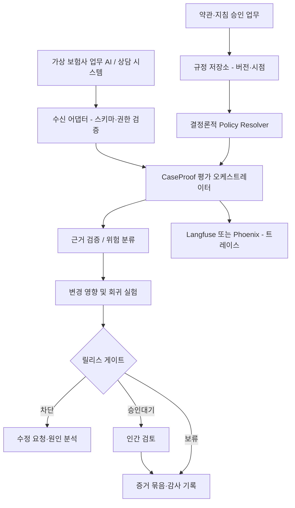

# CaseProof Enterprise v4.0 — 실사용 기준 제품 정본 (105점 목표)

> **현재 상태**: 금융권 AI 보증·변경 통제 시스템의 설계+합성 참조 구현. 실 고객 데이터 사용, 운영 서버 구축, AI 성능 검증, 규제 준수 인증, 실제 보험업무 승인 실적 모두 **없음**. 이 문서에서 '목표'는 통과한 결과가 아니다.

## 1. 제품 정의와 포지셔닝

- 제품: **Insurance AI Assurance & Change Intelligence** — 보험업무 AI의 결과·근거·적용 규정·업무 권한·변경 영향을 연결하는 독립 검증 계층.
- 구매/이용자 가정: 보험사 AI/DX 기획, 보험업무 책임자, IT 개발·운영, 정보보호, 내부통제·감사 조직.
- JTBD: '이 AI 변경을 다음 주 고객 응대 업무에 적용해도 되는가?'에 대한 재현 가능한 증거를 만들고 **사람이** 최종 결정한다.
- 첫 실제 문제: **개정 약관 버전이 혼용되어 보험 상담 AI가 적용되지 않는 기한을 안내할 위험**.
- 처음부터 지원하지 않는 것: 보험금 지급 여부 자동 결정, 법률적 확정 해석, 실제 고객정보 SaaS 수집, 여러 대기업의 내부 시스템 구조를 안다는 주장, 완전 자율 에이전트 회사.
- 다기업 공통성: `tenant` 분리 + `workflow_pack` 계약 + `rule_revision` + `change_impact` + `evaluation` + `release` 코어. 보험사 로고만 바꾸는 멀티테넌시가 아니다.

## 2. 근거-설계-실험 분리 원칙

| 수준 | 허용되는 문구 | 금지되는 문구 |
|---|---|---|
| 조사됨 | 'KB손해보험은 AI 에이전트의 역할·권한·이력을 관리한다고 발표' | 'KB손보가 CaseProof를 요구한다' |
| 설계됨 | '승인 전 데이터 사용 금지 규칙을 제안' | '금융위 인증 획득' |
| 참조 구현 테스트 | '합성 규칙과 관리 로직의 유닛 테스트 통과' | '실제 보험 AI의 신뢰성이 입증' |
| 검수된 오프라인 평가 | '공개/합성 360건 중 n건, 95% CI' | '실제로 60% 비용 절감' |
| 모의 실무 테스트 | '참가자 n명, 작업 시간 중앙값 x초' | '보험사 임직원이 실제 도입 완료' |

## 3. 대상 업무 4개 (확장 모듈은 우선순위)

| Pack | 업무 입력 | 핵심 위험 | 기준 날짜 | 최종 출력 | 우선순위 |
|---|---|---|---|---|---|
| P-01 손보-고객 안내 | 사고정보, 계약일, 특약, 약관 문서, AI 안내문 | 적용되지 않는 약관·보장 조건 안내 | 계약일/사고일/청구일 중 **규칙별 명시** | 설명문 오류·근거·수정 요청 | P0 |
| P-02 생보-청구서류 지원 | 합성 진단서·청구서 OCR 결과, 상품·특약 | 누락 항목·규정 버전·OCR 오독 | 청구일/계약일 중 **규칙별 명시** | 보류·보완 요청·검토 목록 | P1 |
| P-03 상담/민원 | 합성 상담 요약, AI 초안, 지침 검색 결과 | 개인정보 누출·근거 없는 확답 | 고객 문의일 + 지침 적용일 | 상담 품질 리뷰 | P1 |
| P-04 내부 AX Agent | 도구 실행 계획, 역할·권한·업무 기록 | 범위 밖 도구 실행·권한 남용 | 사건 시각과 권한 유효시각 | 실행 BLOCK/HOLD + 로그 | P2 |

**주의:** 날짜 선택 정책 자체를 모델에 추론시키지 않는다. 도메인 운영자가 승인한 정책 메타데이터(`date_basis`)가 정본이다. 모르면 INCONCLUSIVE / REVIEW로 보낸다.

## 4. 제품 설계 핵심 결정 (ADR)

- **ADR-001** 검증 계층은 Agent 구현을 교체하지 않는다. HTTP/파일/OTel 연결 어댑터로 기존 결과를 받아 평가.
- **ADR-002** 원문·버전·조항 출처는 승인된 공급원만 사용. 등록 즉시 PUBLISHED 금지; 2인 검수 후 게시.
- **ADR-003** 세 시각을 별도로 기록: `business_effective_time`(업무 적용 시점), `recorded_at`(DB에 알려진 시점), `evaluated_at`(평가 실행시점). 수정해도 과거 검증 재현성을 유지.
- **ADR-004** 결과를 `CONTENT_CORRECTNESS`, `SOURCE_AUTHORITY`, `RELEASE_AUTHORIZATION`으로 분리. 문장이 맞아도 승인 없는 출처이면 사용 불가.
- **ADR-005** 치명적 오류 1개라도 새로 생기면 평균 점수 개선과 무관하게 출시 자동 차단. 단, 치명도 정의·검수 필요.
- **ADR-006** 데이터 격리는 로그인된 actor tenant + DB Row-Level Security + 복합 외래키 검증. Python 매개변수 tenant만으로 보장하지 않음.
- **ADR-007** 감사 증명은 canonicalized JSON 해시, 이벤트 체인, 외부 해시 앵커로 층화. 참조 구현은 첫 두 항목 일부만 지원. 완전 불변 보장 주장 금지.
- **ADR-008** 모델-판단자(LLM-as-judge)와 규정 결정 엔진을 분리. 날짜·수치·특약 우선순위는 결정론적 규칙이 정본; 의미 유사성·표현 평가에 LLM 사용.
- **ADR-009** 승인 UX는 결과를 'PASS'라고 보여도 자동으로 `APPROVED`로 바꾸지 않음. 모든 승인에는 역할·사유·증거 해시·버전 낙관적 잠금 사용.
- **ADR-010** 범용 트레이싱·프롬프트·보안 평가를 복제하지 않음. Langfuse/Phoenix/Promptfoo를 채택 또는 비교군으로 연결.

## 5. 시스템 컨텍스트

`Langfuse/Phoenix`는 도입된 실기능이 아니라 **연결 후보**다. 실제 호환성 시험 전에는 채택 확정 표현 금지.

## 6. 참조 논리와 프로덕션 경계

1. 로컬 참조 모듈: `resolver.py`, `impact.py`, `release_gate.py`, `governance.py`, `evidence_pack.py`, `paired_benchmark.py`. 모두 합성 데이터·표준 라이브러리 기준.
2. 실제 구축 필수 인프라: PostgreSQL 이중 테넌트 FK/RLS, 인증 제공자, 서버 트랜잭션, 서명/외부 앵커, 재시도 작업 큐, 객체 저장소, 관측성, OpenAPI 검증, 프론트엔드.
3. 실제 금융사 배포: 데이터주체 동의·보관정책·위탁, 네트워크 규정, 개인정보 영향평가 해당 여부, 회사 보안 정책은 기업별 검토. 이 포트폴리오는 어떤 기업의 승인도 대신하지 못함.

## 7. 성공의 정의: '멋진 데모'가 아니라 반복 가능한 실무 결과

- **작동 시나리오:** 가상 구약관 계약에서 AI가 신규 약관의 청구기한을 안내 → 시점 엔진 불일치 검출 → 담당자 원문 확인 → 수정 요청 → 새 답변 회귀 검사 → 승인자 독립 승인 → 증거 ZIP 검증.
- **테스트 기대:** 관련 규정 변경 시 영향받는 테스트 100% 선택(검수된 그래프 범위 내), 검수된 신규 치명오류 0건 허용, 교차 테넌트 API/DB 접근 0건 허용.
- **사용성 목표:** 비개발자 5~8명(가능 시)에게 첫 사례 과제 제시 후 수행률·시간·오인 승인 비율 측정. 참가자가 금융 실무자가 아니라면 그 한계를 명시.
- **비교 실험:** 기존 프레임워크 단독 구성 대비, 동일한 평가 데이터/모델/실험 시간/평가자/비용 기록 아래 위험 발견률과 분석 소요시간 비교.
- **증거 우선:** KPI의 분자·분모·원시 결과·판정자·실험 버전을 공개 가능 범위에서 같이 제시.
