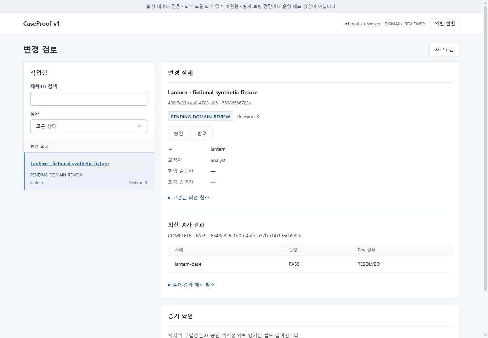
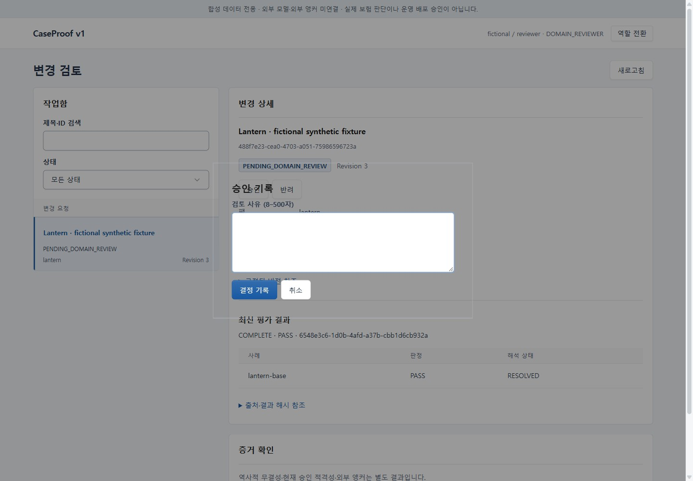
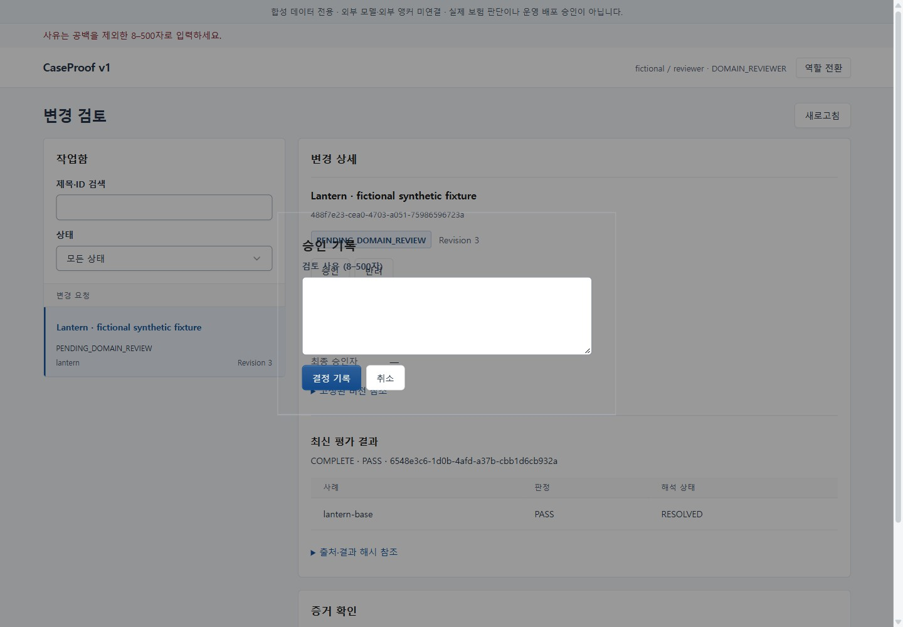
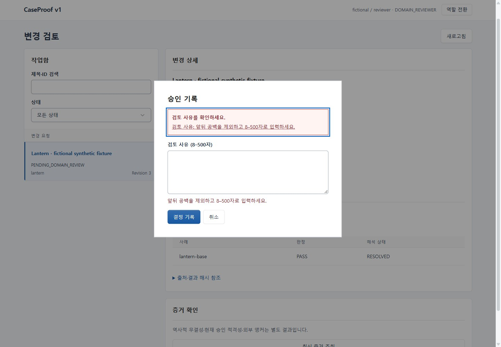
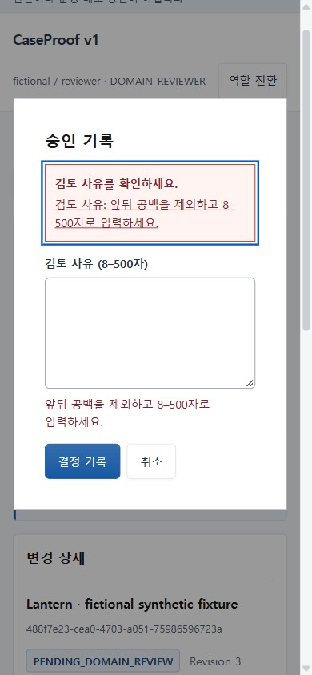
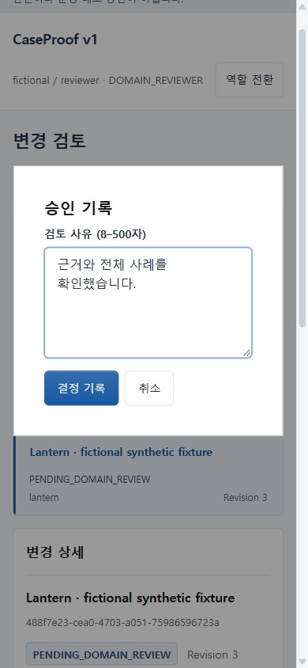
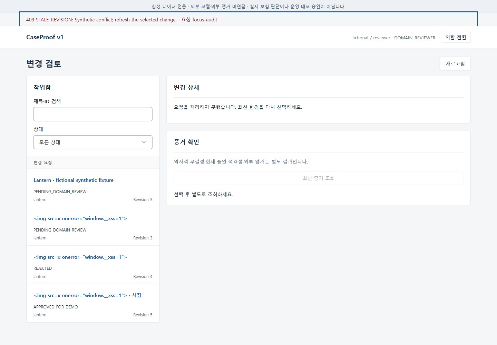

# 검토 결정 흐름 UX 감사 — 2026-11-01 KST

목표는 대기 중인 합성 변경의 평가·근거를 확인하고, 사유를 입력해 결정을 기록하는 흐름이다. 기존 `/v1` 코드와 Tabler 스타일을 대상으로 했다. 새로운 앱·템플릿·페이지·배포를 만들지 않았다. 아래 화면은 이번 감사에서 직접 캡처하고 저장 파일을 열어 확인했다.

UI/UX Pro Max의 `error summary validation --domain ux` 검색은 오류 요약의 초점, 잘못된 필드로의 링크, 연결된 인라인 오류를 제안했다. Product Design의 index/audit/user-context와 감사 프레임워크를 읽고 preflight를 실행했으며 저장된 별도 사용자 문맥은 없었다. Frontend Design과 Uncodixfy로 기존 정보 계층·팔레트를 유지하고 장식적인 새 요소를 배제했다. [실제 스킬·도구 기록](evidence/g1-g6/ux-tools-skills.json), [공식 비교 사례·라이선스](AI_UI_REFERENCES.md)를 함께 확인한다.

## 캡처별 관찰과 수정

1. **작업함 → 상세: 통과.** 목록과 선택 제목·상태·revision, 실제 역할별 결정이 같은 화면에 있다. 선택 표시와 전체 평가 결과를 유지한다.

   

2. **결정 모달 열기: 시각 문제 발견 후 수정.** 텍스트 입력 초점은 올바르게 들어갔지만 배경이 투명해 뒤의 상세가 겹쳐 보였다. 기존 surface 색으로 불투명한 배경을 명시했다.

   

3. **공백 사유 제출: 오류 회복 문제 발견 후 수정.** 앞뒤 공백을 제거하면 유효하지 않은 사유인데 오류가 모달 밖에 표시되고 초점은 제출 버튼에 남았다. 모달 내부 alert·요약 초점·입력칸 링크, `aria-invalid`와 연결된 인라인 오류를 추가했다. 잘못된 입력은 POST를 보내지 않는다.

   

   

4. **390px 오류 상태: 통과.** 문구와 링크가 줄바꿈되고 문서 가로 넘침이 없다. 기존 모바일 입력·버튼과 오류 링크의 터치 크기를 유지한다.

   

5. **입력 수정: 통과.** 요약 링크는 사유 입력칸으로 초점을 옮긴다. 유효한 입력으로 수정하면 요약·인라인 오류와 invalid 속성이 해제된다. 내부 공백을 포함한 기존 8–500자 규칙은 유지한다.

   

6. **Escape·다시 열기: 통과.** Escape로 닫으면 원래 결정 버튼으로 초점이 복귀하고, 다시 열면 이전 오류가 남지 않는다. 1440/390px에서 native 키 입력으로 검사했다.

7. **서버 오류 안내: 통과.** 합성 409 응답으로 모달 종료 후 오류 요약에 초점이 유지되는지 확인했다. 확정된 실패는 최신 변경 재선택을 안내하고 미확정 결과는 원래 요청 복구를 안내한다. 실제 오류는 alert, 일반 성공 문구는 중립 status다.

   

## 실행 증거와 한계

[Native 검사 기록](evidence/g1-g6/ux-native-workflow.json): Chrome 156, 1440/390px, 잘못된 공백·짧은 사유의 POST 0건, summary/link 초점, 오류 초기화, Escape, 불투명 배경을 확인했다. 원래 감사 fixture는 revision 3·결정 0개를 유지했다. IAB에서는 잘못된 토큰의 실제 401 후 `message` 초점과 alert/assertive 속성도 관찰했다. 캡처와 반복 가능한 회귀에는 기존에 승인된 Playwright MCP를 사용했다.

같은 최신 UI에서 전체 평가 → 성공 commit 뒤 응답 유실 → 같은 키 복구 → 반려 → 연결된 시정 → 서로 다른 검토자 승인 → VALID 증거 흐름도 다시 통과했다. RequestClient 접두부는 `de1fc5e`와 원본 바이트가 같고 서버의 권한·멱등성 코드는 변경하지 않았다. [표적 Python 검사](evidence/g1-g6/ux-final-target.txt)는 3 PASS/선택 Python-browser 1 SKIP이며 실제 MCP 실행과 구분한다.

409는 화면 오류 처리를 위한 주입 응답이며 서버 동시성 검증으로 세지 않는다. 통합 probe의 첫 실행은 상세 로딩 대기 누락으로 실패했고, 결정 버튼이 보일 때까지 기다리도록 수정한 뒤 다시 실행했다. 실패를 애플리케이션 결함이나 PASS로 합산하지 않았다. 화면과 DOM 검사만으로 스크린리더 발화, 전체 WCAG 준수 또는 독립 사용자 연구를 검증했다고 주장하지 않는다. 외부 모델·독립 앵커·전문가 검수도 이 감사의 증거가 아니다.
