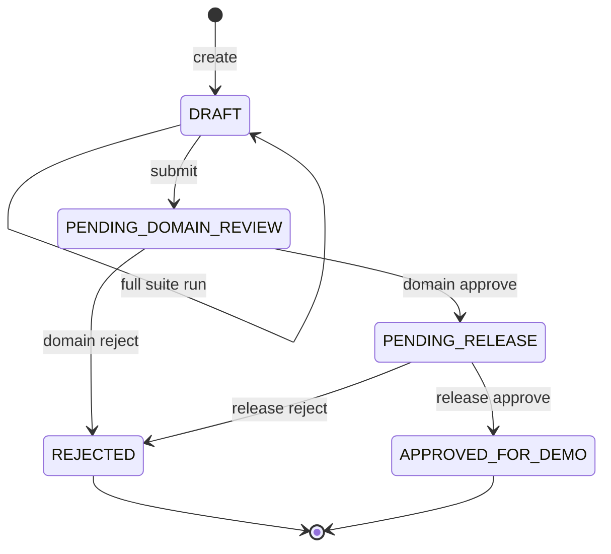

# CaseProof v5.3 목표 설계

2026-10-29 · **실행 기준선과 미래 목표를 구분하는 구현 인계 설계**. 정확한 wire/DB/hash 계약은 [08_IMPLEMENTATION_CONTRACTS.md](08_IMPLEMENTATION_CONTRACTS.md), 검증 사실은 [VALIDATION](../docs/VALIDATION.md)가 정본이다.

## 1. 제품 목적과 좁은 첫 사용자

금융 AI 답변 변경을 검토하는 분석가·업무 검토자·최종 승인자·감사자가 **어떤 후보를, 어떤 규정 시점과 사례로 검증했고, 누가 무엇을 확인했는지** 재현하도록 돕는다. 최초 사용자는 합성 자료로 설치·테스트하는 개발자다. 보험사 납품, 법규 인증, 지급·인수·계약 결정과 실제 배포 실행은 범위 밖이다.

가치 가설은 평균 점수 개선 자체보다 위험한 변경의 발견, 실패 원인의 설명, 검토자 간 책임 분리, 변경에 묶인 증거의 재현이다. 고객 수요·ROI·경쟁 우위는 인터뷰와 동일 조건 실험 전 가설이다. AI가 연결되지 않아도 로컬 생성·평가·검토·감사는 동작해야 한다.

## 2. 지금 있는 것과 앞으로 만들 것

| 영역 | 현재 v5.3 baseline | 목표 v1 |
| --- | --- | --- |
| API | `/api`, 기존 HTTP 계약 유지 + 보안/검증 수정 | `/api/v1`, 공통 오류·revision·전역 actor key |
| 평가 | 단일 숫자 일수, 공개 합성 규칙 10개/사례 20개 | immutable full-suite run, 명시적 coverage, 최신 run gate |
| 승인 | 3인 분리, 기존 audit 순서 재구성으로 상태 교차 검증 | ChangeRevision/Transition/Decision/Audit를 원자적으로 저장 |
| 증거 | 내부 SHA 체인/행 대조, DB 전체 재작성에 취약 | 목적별 hash, 고정 assessment + 최종 envelope, 후속 외부 anchor |
| DB | 로컬 SQLite 1 worker | 실제 PG migration/role/RLS/동시성 검증 |
| 재시도 | evaluation의 기존 제한적 키 처리 | 모든 mutation의 `(tenant,actor,key)` key 공간 |
| UI | 생성→두 숫자 평가→검토→승인→증거 | 반려 시정, full-suite 결과, 응답 유실 복구·접근성 |
| 실증 | 이번 실행한 테스트 결과만 | SME 2명 이상, 160/80/120 연구, 외부 설치·운영 훈련 |

baseline hardening이 G1 전체 완료를 의미하지 않는다. 현재 검증된 범위와 미구현 범위는 [STATUS](../docs/STATUS.md)에서 추적한다.

## 3. 설계 선택

| 선택지 | 평가 |
| --- | --- |
| status 행과 단순 체크만 보강 | 변경량은 작지만 상태·결정·감사 누락의 정합성을 설명하기 어렵다. baseline의 긴급 수정에만 사용 |
| **모듈형 단일 서비스 + 불변 전이/snapshot + 원자적 projection** | 기존 FastAPI/SQLAlchemy와 연속성이 있고 각 불변식을 테스트로 연결할 수 있다. v1 기본안 |
| 전면 event sourcing/다중 서비스/외부 WORM부터 구축 | 현재 1인 합성 시제품보다 운영 부담이 크다. 검증된 핵심 흐름 이후 선택 |

이 선택은 사용자 요청을 달성하기 위한 구현 기본값이다. 프런트엔드 프레임워크 교체와 GPU/LLM 구입을 시작 조건으로 만들지 않는다. 선행 결함을 해결하기 전에 평가 도구를 여러 개 연결하여 범위를 늘리지 않는다.

## 4. 모듈 경계

- `service/api/v1.py`: HTTP/DTO/header/error mapping. 도메인 판단·SQL 여러 곳에 복제 금지.
- `service/auth.py`: authenticated ActorContext 및 현재 권한. G2 registry bootstrap/SSO adapter 경계.
- `service/domain/state_machine.py`: 순수 상태·역할·revision 규칙.
- `service/domain/canonical.py`: `caseproof.c14n.v1`, 목적별 hash, golden vectors.
- `service/domain/gates.py`: 최신 complete run/coverage/critical/source veto.
- `service/domain/evidence.py`: 고정 revision에서 assessment/envelope 재구성.
- `service/commands.py`: 공통 transaction/lock/idempotency/CAS 및 명령 조정.
- `service/models_v1.py`, `migrations/`: 복합 tenant FK·UNIQUE와 불변 기록의 DDL.
- `service/policies/`: pack/source/time/rider resolver와 검증된 source registry.
- `service/evaluation/`: fake adapter/full-suite run; 이후 job/worker와 외부 adapter.
- `service/static/`: 사용자 화면, 토큰 메모리 보관, 안전한 렌더링. 서버가 권한의 정본.

파일 생성은 해당 task에서 수행한다. 폴더만 미리 많이 만드는 scaffolding은 완료 기능으로 세지 않는다.

## 5. 핵심 불변식

| ID | 반드시 유지할 조건 |
| --- | --- |
| I-01 | tenant/actor/role은 서버 인증 결과에서만 얻고 모든 객체·FK에 tenant를 포함한다. 타 tenant는 404 |
| I-02 | Change projection은 genesis부터 전이를 재구성한 상태·revision·담당자와 같아야 한다 |
| I-03 | 매 전이는 revision+1, snapshot 1개, transition 1개, audit event 1개; 결정 단계에는 note 1개 |
| I-04 | 업무 기록·감사 head·성공 idempotency 결과는 한 transaction에서 모두 commit 또는 rollback |
| I-05 | 잠금 순서는 tenant head → change → 관련 행 table/PK 정렬 → idempotency. network I/O를 그 안에서 금지 |
| I-06 | workflow revision과 candidate 내용 snapshot ID를 구분한다. snapshot 내용 변경은 새 change |
| I-07 | 전체 mutation에 `(tenant,actor,key)` UNIQUE. route/resource/body/revision은 request fingerprint에 포함 |
| I-08 | 인증/현재 권한 이후 replay를 stale 검사보다 먼저 수행. replay는 과거 결과이며 최신 integrity 판정이 아님 |
| I-09 | 최신 committed full-suite run만 gate 근거다. 최신 incomplete/failed를 옛 PASS로 대체하지 않는다 |
| I-10 | assessment는 승인 직전 p까지 고정, release event는 그 hash, envelope는 최종 event를 참조. 자기 hash 순환 없음 |
| I-11 | requester/owner, DOMAIN reviewer, RELEASE approver는 서로 다른 사용자 ID; 다중 역할로 우회 불가 |
| I-12 | UNKNOWN/INCONCLUSIVE/미승인 출처/누락 증거/치명 오류는 PASS·자동 승인으로 바꾸지 않는다 |
| I-13 | 과거 실패·반려·승인·source를 덮거나 추측한 과거 event를 생성하지 않는다 |
| I-14 | model input과 private gold를 분리. 공개한 데이터는 blind라고 재주장하지 않는다 |
| I-15 | 실제 실행하지 않은 PG/browser/외부 검수는 PASS 또는 105점 근거가 아니다 |

## 6. 상태·시정

반려된 change는 terminal이다. 같은 tenant에 새 child change를 만들고 parent relation만 보존하며 평가·승인을 복사하지 않는다. DRAFT에서 run을 재실행하면 이전 결과를 남기고 full suite를 다시 기록한다. 후보 코드/모델/프롬프트/출처 내용이 바뀌면 새로운 candidate snapshot과 change가 필요하다.

## 7. 위협·신뢰 경계

외부 HTTP 입력·모델 출력·검색 자료는 불신 입력이다. SQL app role, migration owner, external anchor writer는 서로 다른 권한으로 관리한다. 정상 사용자 간 격리, object authorization, state-row tampering, 누락/중복/역순, lost response와 경합을 테스트한다.

내부 SHA 체인은 DB 전체와 head를 다시 쓰는 owner 공격에 독립 증거가 아니다. RLS GUC context는 SQL injection으로 장악된 app role의 신원을 증명하지 않는다. local bearer tokens는 만료·MFA·SSO가 없는 demo 수단이다. 이러한 범위 차이는 UI·README·release에 함께 표시한다.

G2 auth bootstrap은 서버 소유 token digest registry에서 tenant/actor를 확인한 뒤 transaction-local context를 넣고 해당 User의 enabled/roles를 조회한다. RLS 적용 전 User 전역 조회를 숨겨 유지하지 않는다. 비밀 registry는 Git에 넣지 않는다. 운영 인증은 별도 검증된 provider로 교체한다.

## 8. 실행·데이터 경계

Python 3.11–3.13, Pydantic2, SQLAlchemy2, FastAPI의 구체 해시는 lock에 기록한다. baseline은 SQLite single worker만 허용한다. 이후 PostgreSQL major version을 G2 문서와 CI에서 고정하고 실제 runtime app role을 검사한다. migration과 seed를 app startup에 자동 실행하지 않는다.

baseline DB는 새 v1 스키마의 원본 사실로 자동 승격하지 않는다. import가 필요하면 원본 SHA를 남긴 `legacy-unverified` 읽기 전용 영역으로 가져오고 신규 승인 이력은 다시 생성한다. downgrade가 사용자 기록을 삭제할 수 있으면 되돌리기보다 검증된 backup restore 절차를 사용한다. 빈 disposable DB의 upgrade/downgrade 시험과 운영 rollback은 다른 계약이다.

## 9. 사용성과 제품 완료 조건

목록·상세·평가·검토·감사의 각 화면에 loading/empty/403/404/409/422/network unknown 상태를 둔다. 이유 입력은 레이블과 오류 설명을 갖고, 색상 외 텍스트로 PASS/BLOCK/INCONCLUSIVE를 표현한다. stale 충돌에서 자동 재승인하지 않는다. 응답 유실 시 pending key/body/revision을 유지하며 동일 요청으로 복구한다. raw SQL/스택·비밀 원문은 사용자에게 내보내지 않는다.

핵심 흐름이 실제 브라우저에서 통과하고 키보드·초점·작은 화면을 확인해야 UI 기능 완료다. 사용자 인터뷰와 접근성 표준 인증은 별도다. 성능 목표는 측정 전에 임의 보장하지 않고 dataset 수·tenant 수·worker·DB·동시성 조건과 p50/p95/p99를 함께 기록한다.

## 10. 단계별 가치

G1은 신뢰 가능한 로컬 승인 흐름, G2는 DB 격리와 경합 증거, G3는 시점·특약을 설명하는 합성 업무팩, G4는 사용자가 복구 가능한 UI, G5는 누수 없는 비교실험, G6는 외부 검수·운영 훈련을 낸다. G1–G4의 오픈소스 demo release는 G5/G6의 외부 사람·비용 없이도 가치가 있지만 그 기능까지 완료했다고 표시할 수 없다.
